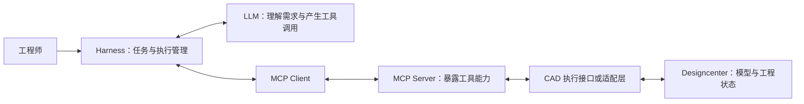

# Designcenter Harness / MCP Server 会前速读

会议日期：2026 年 10 月 13 日。面向后端开发旁听人员，建议阅读时间约 10 分钟。

本文根据提供的议程整理。这里将 Harness 理解为 AI Agent 的执行与编排环境；工程院团队的具体实现需要现场确认。公开资料可以核对 MCP 的通用概念，但本次未找到 Designcenter 2612 MCP Server 的完整官方技术说明，因此不预设其部署方式、工具清单、许可、离线能力及版本兼容性。

## 先建立一个整体认识

这次会议围绕一条工程任务执行链：工程师描述需求，Harness 组织大模型和工具，MCP Server 暴露 CAD 能力，Designcenter 实际读取或修改工程模型。

你旁听时的主要目标，是看清连接关系、业务状态和责任边界，以及部署完成后如何判断一次任务确实成功。



这是概念示意，具体进程如何合并、CAD 适配层是否使用 NXOpen，均需西门子确认。MCP 标准采用 Host、Client、Server 架构：Host 组织 AI 应用，Client 与 Server 通信，Server 提供工具和上下文。[MCP 官方架构说明](https://modelcontextprotocol.io/docs/2026-07-28/learn/architecture)

## 1. 会上术语怎么理解

| 术语 | 对后端开发的理解 | 简单例子 |
| --- | --- | --- |
| Designcenter / NX | 实际承载模型、装配、图纸等工程数据的 CAD 应用；本议程按 NX 相关体系理解，具体产品模块需确认 | 打开一个装配，修改零件参数并重建 |
| NXOpen | NX 的二次开发 API，可以将工程操作写成程序 | 用 C# 或 Python 查询模型、操作特征 |
| LLM | 理解自然语言、提出步骤和工具参数的模型服务 | 将“孔径改为 12 mm”转成参数修改意图 |
| Agent | 结合大模型和工具，持续执行任务并处理反馈的逻辑 | 读取模型、修改参数、检查结果，再决定下一步 |
| Harness | 运行 Agent 的外层环境，负责工具接入、上下文、任务、权限与执行记录等；实际功能依团队实现 | 接收任务，组织模型调用，执行工具并记录结果 |
| Skill | 某类任务的可复用操作说明、规则、脚本或资源，包装方式依团队实现 | 按企业规范修改钣金参数的步骤与校验规则 |
| Workflow | 将步骤、依赖、分支、人工确认和失败处理组织起来的流程 | 读取模型 → 修改 → 校验 → 保存 → 生成报告 |
| MCP Server / Client | Server 发布可调用能力，Client 负责协议通信；AI 应用通常通过其 Client 调用 Server | 发现工具并发送结构化调用 |
| CLI | 通过命令行调用功能的一种入口，可能被包装成 MCP 工具 | `cad-tool inspect --part demo.prt`，仅为示意 |

Skill、Workflow 属于任务组织方式，MCP 定义工具与上下文的通信方式，CLI 是一种执行入口；它们可以组合。西门子的工程 Agent 公开文章也将任务 Agent、编排器、Skills 和 Workflows 分别讨论，但这不证明工程院当前系统使用其中某个具体框架。[西门子工程 Agent 架构介绍](https://blogs.sw.siemens.com/art-of-the-possible/agentic-ai-aided-engineering/)

西门子资料将 NXOpen 描述为用于定制和自动化 NX 的编程 API；2512 的官方课程仍使用 Designcenter NX / NX 2512 名称。[NXOpen 官方介绍](https://blogs.sw.siemens.com/designcenter/siemens-open-plm-components-sdks/) · [NX 2512 官方课程](https://training.plm.automation.siemens.com/ilt/iltdescription.cfm?pID=b5f9a350-abe5-396c-a650-891b61260672)

用已有 SW 插件经验类比：NXOpen 对应你熟悉的 SW API；MCP Server 提供统一的工具入口；Harness 进一步把工程操作组织成 AI 任务。

## 2. 一次真实任务怎样经过这条链

以“把指定零件的孔径改成 12 mm，并检查和保存”为例，假设工具已经提供这些操作：

1. Harness 获取用户身份、目标模型、当前版本和允许的操作。
2. MCP Client 获取工具清单及输入参数定义，Harness 将必要信息提供给大模型。
3. 大模型产生读取/修改工具的调用意图；Harness 执行权限和参数检查后派发。
4. MCP Server 校验请求，再由 CAD 适配层对正确的文档执行修改。
5. 工具返回执行结果；Workflow 继续组织重建、约束校验、保存和结果记录。

以下只是工具名称与参数的概念示例，不是西门子 2612 已确认提供的工具，也不是完整 MCP 请求：

```json
{
  "name": "set_parameter",
  "arguments": {
    "modelId": "demo-part",
    "parameter": "HoleDiameter",
    "value": 12,
    "unit": "mm"
  }
}
```

MCP 工具通过输入 Schema 描述参数，常见操作包括 `tools/list` 和 `tools/call`。工具执行错误与协议错误有不同的表达方式，业务层应读取结果和错误字段，而不只看 HTTP 状态码。[MCP 工具说明](https://modelcontextprotocol.io/specification/2025-11-25/server/tools)

这条链有三类成功条件：协议请求成功、CAD 操作成功、工程校验通过。部署验收应分别记录它们，避免只用“请求返回了”代表任务完成。

## 3. 后端视角下，MCP 和常见接口的关系

MCP 的消息层使用 JSON-RPC。相比只约定一个业务 URL，还提供能力发现、工具参数描述、上下文资源和其他协议能力。你仍需设计业务鉴权、任务管理、日志、错误处理和工程状态保护。

Server 常见能力分为：Tools（可执行动作）、Resources（供应用读取的上下文数据）、Prompts（可复用提示模板）。服务端提供哪些能力、工具叫什么及调用粒度，需看它实际发布的清单。[MCP Server 概念](https://modelcontextprotocol.io/docs/2026-07-28/learn/server-concepts)

| 连接方式 | 后端需要理解的部署含义 | 会上要确认 |
| --- | --- | --- |
| stdio | Client 通常启动一个本机子进程，通过标准输入输出通信 | 谁启动进程，程序路径、运行账户、环境变量和日志如何配置 |
| Streamable HTTP | Client 访问网络服务，可能使用 SSE 传递流式消息 | 地址、TLS、代理、鉴权、超时和多 Client 支持 |
| HTTP+SSE 旧传输 | 一些既有实现仍采用早期连接方式 | 是否需要兼容，Client 与 Server 是否支持同一种方式 |

SSE 在这里表示服务端向客户端持续发送事件的 HTTP 数据流。Streamable HTTP 也可以使用 SSE，但不能因此把它与旧 HTTP+SSE 传输当作同一套连接接口。[MCP 传输规范（2025-11-25）](https://modelcontextprotocol.io/specification/2025-11-25/basic/transports)

MCP 协议有不同版本，发现能力、初始化和连接状态的处理也会随版本变化。会上需确认西门子 Server 与现有 Harness 的协议版本、SDK 和传输方式，不能只根据“都支持 MCP”推断直接兼容。

## 4. CAD 接入最值得关注的四个后端问题

### 工程会话与并发

CAD 有当前文档、装配配置、选择集和未保存内容。即使 MCP 传输无状态，这些工程状态仍然存在。需要明确：一个请求绑定哪个 CAD 实例、用户和文档？同一模型的修改如何排队？能否并发读取？多用户是否拥有独立实例和许可？

你熟悉的 Web 服务水平扩容不能直接证明 CAD 执行层也能同样扩容，必须看产品支持的实例和会话模型。

### 超时、重试与幂等

创建或修改模型的请求超时后，CAD 可能已经执行成功。后端应能区分“明确失败”和“结果暂未知”。会上要确认是否有任务状态查询、执行记录、取消和幂等支持；JSON-RPC 的请求 `id` 用于关联消息，本身不等于防重复执行的业务幂等键。

### 失败恢复与验收

Workflow 中某一步失败，要明确前面修改如何处理：撤销、保留临时结果，还是从模型副本重新开始。验收证据最好包含重建结果、几何/规则检查、保存位置和版本，而不仅是模型截图或聊天里的成功描述。

### 身份、数据和审计

LLM 访问凭据、MCP Server 访问身份、CAD/Teamcenter 的工程数据权限，应分别对齐。需确认模型名称、属性、截图、日志或文件中的哪些数据进入推理服务，以及审计是否能关联用户、任务、工具调用和模型版本。HTTP MCP 的官方授权机制以 OAuth 为基础，产品实际支持的企业认证方式需现场确认。[MCP 授权说明](https://modelcontextprotocol.io/specification/2025-11-25/basic/authorization)

## 5. 按三个议程怎么听

| 议程 | 你应该关注的内容 | 希望得到的材料 |
| --- | --- | --- |
| 工程院 2512 Harness 现状 | 当前如何执行 CAD 操作；哪些已稳定复用；哪些依赖人工；耗时与失败点；Skill/Workflow 的实现方式 | 现状架构图、能力清单、一次完整调用记录和已有用例 |
| 西门子 2612 MCP Server 演示 | 查询还是能修改；工具粒度；支持哪些工程模块；支持现有 Harness 和内网大模型的条件 | 工具及 Schema 清单、最小调用样例、部署/许可/兼容说明 |
| AI 实验室部署对齐 | 机器、网络、身份、文件与许可如何准备；各层由谁负责；验收是什么 | 环境清单、连接拓扑、责任人、日期与 Open Items 表 |

一个有价值的演示会展示完整过程：发现能力 → 读取目标 → 执行操作 → 校验 → 保存 → 查询执行记录。可以关注是否也演示参数不合法、权限不足或操作失败后的处理。

## 6. 部署需要拆成哪些连接

不要只记录“开一个 MCP 端口”。至少应梳理以下连接，实际是否存在依部署方案而定：

| 连接 | 需要对齐 |
| --- | --- |
| Harness → LLM | 模型地址、认证、工具调用输出支持、上下文大小、超时、数据是否出内网 |
| Harness 的 MCP Client → MCP Server | 协议版本、传输方式、URL 或启动命令、TLS、代理、身份与权限 |
| MCP Server → CAD 执行环境 | 同机还是远程，插件或适配层，是否需要桌面会话，绑定与并发机制 |
| CAD → 许可证服务/工程文件/Teamcenter | 许可、测试账户、路径、读写权限及工程数据版本 |

远程 MCP Server 可用，并不自动意味着 CAD 进程支持无界面、容器化或 Windows Service 运行。这些都是本次应向西门子确认的产品条件。

## 7. 若只记五个问题

1. **能做什么：**正式支持的工具清单有哪些，读取、修改和自定义工具分别到什么范围？
2. **怎么连：**现有 Harness 接入需要哪些协议版本、配置、SDK 及模型工具调用能力？
3. **怎么跑：**需要什么操作系统、CAD build、许可和桌面会话，是否支持多用户与后台执行？
4. **出错怎么办：**并发修改、超时、重复调用、撤销和结果查询分别如何处理？
5. **如何交付：**谁提供安装包和文档，谁准备环境和权限，用哪些用例验收，完成日期是什么？

## 会中记录模板

| Open Item | 当前不明确的内容 | 负责人 | 关闭条件/需要提供的材料 | 截止日期 |
| --- | --- | --- | --- | --- |
| 工具能力 | 2612 工具覆盖、限制及扩展机制 | 西门子指定负责人 | 工具与 Schema 清单、调用样例 | 待定 |
| 部署与许可 | 软件 build、OS、CAD 会话、许可与离线条件 | 西门子＋实验室指定负责人 | 环境及许可要求确认 | 待定 |
| Harness 接入 | Client、SDK、协议及传输是否匹配 | 工程院指定负责人 | 最小链路调用通过 | 待定 |
| 模型接入 | 内网 LLM 的工具调用能力及认证 | 模型平台指定负责人 | 一次工具调用闭环验证 | 待定 |
| 网络与权限 | 路由、代理、证书、文件与工程账户 | IT/安全/工程管理员 | 连通性与权限检查完成 | 待定 |
| 业务验收 | 典型 CAD 操作及失败恢复 | 业务＋开发指定负责人 | 明确用例、通过标准和结果记录 | 待定 |

表中仅列出建议的责任类型，具体人员和日期应在会上确认。旁听后的有效产出，是能复述调用链，并把缺少的部署条件落成有负责人和关闭条件的待办事项。
