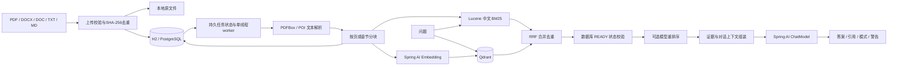

# 架构与迭代指南

## 原工程与改造

原项目只有 Spring Boot HTTP 服务、一个原生聊天页面和官方模型 SDK 调用，按 sessionId 在内存保存多供应商对话。没有文档、索引、数据库、权限、任务状态与检索协议。

现在沿用 Java 17 / Spring Boot 4.1.1，以 Spring AI 2.0.1 统一聊天与 Embedding 调用。旧 ChatController 默认禁用，避免无界会话与 GET 聊天端点成为旁路。原代码与原测试仍保留，便于追溯。

文档模式采用确定性 RAG 管线。新增的显式 NX 模式使用有界 Agent 工具循环，经 MCP 读取实时状态、生成计划；写入必须经过持久审批。详细边界、实例部署与生产迭代见 [NX MCP 接入](MCP_NX.md)。

## 数据流

## 模块边界

| 包 | 职责 | 迭代入口 |
|---|---|---|
| api | 验证、鉴权、REST、POST SSE、ProblemDetail | 新 DTO、公司身份接入、限流 |
| service | 上传生命周期、持久任务、问答证据组装 | 工作流、重试策略、异步任务租约 |
| ingest | 文件解析、页码/章节、分块 | OCR、版面识别、更多文件格式 |
| retrieval | VectorIndex、Qdrant适配、Lucene、RRF、重排 | 共享关键词搜索、更多向量库、检索评测 |
| model | Spring AI模型客户端 | 模型供应商、用量记录、网关集成 |
| store | JDBC元数据、片段与状态 | 文档ACL、版本管理、审计 |
| config | 外部配置、启动约束、OpenAPI | 配置中心和部署profiles |

## 状态与一致性

文档状态为 QUEUED → PROCESSING → READY / FAILED；删除请求立即改为 DELETING，后台依次清理向量、关键词索引、原文件与数据库记录。删除失败保留任务，至少等待30秒后重试。FAILED与READY支持手动重新索引。

数据库是来源与可见性的最终依据。检索候选必须映射回当前数据库里的 READY 片段，尚在入库、失败或删除中的记录不会成为新答案证据。回答结束时再次检查来源状态，但这不是并发权限撤销的强事务保证。

文件先写临时文件，完整保存后再插入任务。SHA-256唯一约束避免重复上传。chunk UUID由文档ID与序号生成，重试替换而非重复追加。启动后 PROCESSING 任务重新入队；Lucene 从 READY chunks 重建以恢复跨存储中断。当前启动重建是 O(总片段数)，大规模部署应换共享搜索引擎或实现增量恢复。

数据库、Qdrant、文件系统之间没有分布式事务。状态门控与幂等清理提供可恢复的一致性；磁盘故障等情况下可能留下不可见的孤立临时文件或向量，需按运行维护流程检查。它们不会仅凭向量命中直接进入模型上下文。

## 检索与模型配置

默认每路召回30条、最终选6条（search接口可选1–12），向量使用Cosine相似度门槛。BM25使用Lucene的SmartChineseAnalyzer。RRF按排名融合，分值不是概率，不能与Cosine或模型重排分值直接比较。

Qdrant通过当前 REST /points/query 接口访问。选择显式轻量适配层是为了固定协议与超时，避免依赖仍调用旧 Search RPC 的适配器。向量模型仍通过Spring AI EmbeddingModel实现，未实现自制向量模型。

Embedding配置签名（基础URL、模型名、维度）附加在collection前缀后。密钥轮换不改变签名。服务验证实际输出维度与非零有限向量；更改维度配置不等于请求模型自动降维。新模型启用后需要重建已有文档。

未配置Embedding时，入库明确标为LEXICAL。向量检索临时失败时显式返回关键词降级模式与warnings；已配置Embedding但入库失败的文档标为FAILED，不能假装完成向量化。未配置重排器时使用RRF；配置重排器失败时也会报告降级。

## 回答与引用

API返回citation数组，答案中的 [1] 对应第一条。引用项保存稳定chunk UUID、documentId、文件名、页码/章节和原文。PDF物理页码可追溯；Word不假设固定分页。

提示词区分指令、历史与文档证据。没有命中时直接返回证据不足，不调用生成模型。仅编号越界可由程序可靠拦截；grounded=true表示答案包含合法的本轮引用编号，不表示已经完成逐句事实核验。

POST SSE依次发送sources、delta、done；出现错误发送error且不发done。delta是未经最终校验的临时文本，客户端以done为准。最多8个并发聊天任务，每个流式生成有120秒总时限、模型网络超时和长度上限。对话历史由调用方携带，最多20条，每条8000字符，总长24000；不在服务端建立无限会话。

## 已实现的边界与上线前工作

当前只有一个共享知识库和服务级Bearer Token。所有持有令牌的同事或业务系统权限相同，不能把前端传入tenantId当作隔离实现。需要权限隔离时，应从认证主体推导访问范围，同时覆盖关键词检索、向量检索、原文件下载、引用与任务管理。

本机无令牌仅允许loopback监听；prod或非loopback监听必须配置令牌。公开GET仅包括静态资源、系统就绪标志、健康与API schema。应用不输出密钥或全文到业务日志；请求有X-Request-Id。

当前文件与Lucene均为单节点本地存储，worker启动恢复没有跨实例租约。不要直接把容器副本数调大。生产化迭代顺序建议：公司SSO/文档ACL → 对象存储/共享关键词索引 → 任务租约/队列 → 真实公司评测与容量压测 → 灰度上线及恢复演练。
