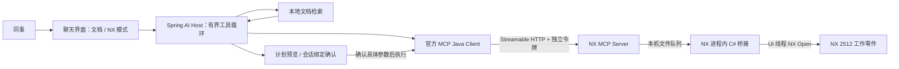

# Siemens NX 2512：RAG、MCP 与实时建模

## 推荐架构

聊天服务是 **MCP Host / Agent 编排器**。RAG 检索公司规范、设计规则与历史文档；MCP 查询当前 NX 状态并提交受控建模计划。两路证据在 Host 汇合，不能以静态文档替代实时模型状态，也不能让文档内容授权写入。



MCP 是协议与工具接口；授权、审批、幂等和 CAD 事务仍是应用责任。传输采用已发布的 2025-11-25 协议能力与 Streamable HTTP，使用官方 SDK，不实现自制 JSON-RPC 协议，也不采用未来 draft 的行为。

**部署原则**：NX MCP Server 与 NX 桥接运行在同一台工程工作站。桥接 DLL 在 NX 内加载，Timer 回调在 NX UI 线程逐个执行。Java、HTTP 和 LLM 的线程不能直接调用 NX Open。后续若 RAG 运行在服务器上，可经认证的 HTTPS 入口访问该工作站的 MCP Server；本次配置只监听 loopback。

## 已实现

| 层 | 实现 |
|---|---|
| Host | `java-chatbot/.../rag/mcp/NxAgentService`，最多 4 轮、顺序工具调用、有界参数/输出；直接 ChatModel 返回工具请求，由 Host 执行 |
| Client | MCP Java SDK 2.0.1：initialize、能力协商、分页 tools/list、tools/call、Streamable HTTP、30 秒请求超时、结果大小限制 |
| Server | `nx-mcp-server`：Spring AI 2.0.1 WebMVC MCP Starter，独立 Bearer 令牌、Origin 检查、严格 schema 与参数范围 |
| Bridge | `nx-bridge/NxBridge.cs`：NX 2512 / .NET Framework、UI 线程、单实例文件锁、截止时间、原子文件交换 |
| 审批与审计 | `tool_actions` 表：会话、冻结的参数与 hash、commandId、计划、状态、结果、过期时间；原子领取，重启将执行中任务标为 UNKNOWN |
| UI | 显式 NX 模式、工具进度、目标零件/原点/尺寸的预览 JSON、确认、取消、查询未知结果 |

### 工具合同

| 工具 | 参数 | 作用 |
|---|---|---|
| nx_get_context | `{}` | 实时工作零件、单位、特征/实体数、实例 ID 与 snapshot；不上传完整文件路径 |
| nx_preview_block | x/y/z、length/width/height，数值且全为 mm | 创建 5 分钟有效的计划，读取并绑定当前工作零件；**仅参数预览，不生成可视化实体** |
| nx_apply_block | planId、commandId | 执行已确认的计划；一计划绑定一个命令；工作零件、实例或 snapshot 变化则拒绝 |
| nx_command_status | commandId | 查询命令回执，不重新执行 |

长方体沿绝对坐标 X/Y/Z，新建独立实体；当前只接受毫米工作零件。长度、宽度、高度范围 `(0,10000]` mm，坐标范围 `[-100000,100000]` mm；NX 桥接也独立校验。NX 插件将尺寸下限限制为 `0.000001` mm，低于此值会拒绝。模型未给出明确尺寸和原点时应询问用户；最终以确认卡片的具体参数为准。

Host 只向模型提供读取和预览工具；`nx_apply_block` 不在模型工具列表内。仅 `/actions/{id}/approve` 在校验会话、参数 hash、过期时间并原子领取后能调用写入。

NX 写入在可见 UndoMark 前显式启用 NX Open Redo，创建失败时回滚并释放 Builder。创建后核查独立实体数量、绝对坐标包围盒、原点和三个尺寸（容差 0.00001 mm），回执返回 `geometryVerified`、`actualBoundsMm` 与 `actualSizeMm`。**不会自动保存零件**，成功后可以在 NX 内 Undo。无任意代码、脚本、命令执行、删除、文件覆盖或导出工具。

DeepSeek 工具规划使用其官方非思考模式，避免跨轮公开聊天历史缺失供应商 reasoning 状态；每轮明确保留配置的模型名。工具参数仍由 MCP Server 和 NX 桥接校验，不依赖模型 strict 输出保证。[DeepSeek 模式合同](https://api-docs.deepseek.com/guides/thinking_mode/)

## 本机启动

要求已有 NX 2512、JDK 17、Maven；脚本沿用项目缓存和日志目录。NX 程序集只从安装目录引用，不复制、不分发 Siemens 二进制文件。

```powershell
# 根目录；UGII_BASE_DIR 指向 NX 2512 安装目录
.\scripts\Build-NxBridge.ps1
.\scripts\Start-NxMcp.ps1
```

Start-NxMcp 为本项目生成独立随机服务令牌并保存到忽略文件 `.local.env`；不会复用 DeepSeek 密钥。编辑 `.local.env`：

```dotenv
RAG_MCP_ENABLED=true
RAG_MCP_URL=http://127.0.0.1:8765/mcp
# NX_MCP_API_KEY 由脚本生成，不在浏览器输入
```

在 NX 打开一个用于测试的毫米零件，通过“文件 → 执行 → NX Open”加载 `.runtime/nx-bridge/NxBridge.dll`。勾选“允许此 RAG 项目…”后立即持续接收请求，**没有也不需要确定按钮**。取消勾选暂停连接，关闭窗口停止桥接。每个目录仅能被一个 NX 实例占用；多个实例必须配置不同目录和明确路由。

在当前 NX 进程更新 DLL 时，Windows 可能锁住旧文件，且 NX 不会卸载已加载程序集。可以执行 `Build-NxBridge.ps1 -OutputName NxBridge.Tested.dll`，关闭旧桥接窗口释放实例锁，再加载新文件并恢复原连接开关。本机当前验证使用该修复版本；新启动的 NX 使用默认名称重新构建即可。

```powershell
# 修改配置或代码后重启 RAG；打包前先停旧 Java，避免 JAR 文件锁
.\scripts\Stop-Local.ps1 -AppOnly
.\scripts\Start-Local.ps1
```

打开 http://127.0.0.1:8090，勾选“NX 实时建模”，先问“读取当前 NX 工作零件状态”，再问“在绝对原点创建长度 100、宽度 50、高度 20 毫米的独立长方体”。核对确认卡片中目标零件和尺寸，再点击“确认并执行”。有任何手工编辑或切换零件后，重新预览。

MCP Server 未运行、NX 插件未加载/未勾选、无工作零件、单位不支持、许可证或 NX 处于不可操作状态时返回失败；不伪装成成功或自动切换到模拟后端。诊断日志在 `.runtime/logs/nx-mcp.*.log`，桥接状态见 `.runtime/nx-bridge/heartbeat.json`。

## 模拟与测试

无需打开 NX 可运行明确的模拟后端，所有结果带 `backend=MOCK`：

```powershell
.\scripts\Stop-Local.ps1 -NxMcpOnly
.\scripts\Start-NxMcp.ps1 -Mock
# 恢复真实后端
.\scripts\Stop-Local.ps1 -NxMcpOnly
.\scripts\Start-NxMcp.ps1
```

模拟不会修改 NX，不能用它证明 NX 内的实际建模、许可证、UI 调度或性能。真实只读/预览测试为显式 opt-in 的 NxMcpLiveReadTest；它不调用 apply。NX 写入验收需要用户确认一个可丢弃测试零件的具体计划，再检查实体、尺寸和 Undo。

## API 集成

沿用 RAG 的服务 Bearer 鉴权。API 客户端须保存会话 cookie（JSESSIONID），浏览器同源 fetch 自动携带；跨会话无法访问、确认或取消他人的计划。当前是会话隔离，**尚无公司用户身份/RBAC**。

| 路径 | 说明 |
|---|---|
| GET /api/v1/agent/tools | 配置与允许的工具列表；会尝试建立连接，配置不等于健康 |
| POST /api/v1/agent/chat | 与普通 ChatRequest 同结构；返回 toolTrace、pendingAction |
| POST /api/v1/agent/chat/stream | SSE：sources → tool/approval → done 或 error；当前为工具进度与最终文本，非逐 token 流 |
| GET /api/v1/agent/actions/{id} | 查询当前会话的持久操作状态 |
| POST /api/v1/agent/actions/{id}/approve | body `{ "argumentsHash": "预览返回值" }`；重复确认不会重复执行 |
| POST /api/v1/agent/actions/{id}/cancel | 只取消尚未开始的计划 |
| POST /api/v1/agent/actions/{id}/reconcile | 用 commandId 查询回执，不重放操作 |

状态：PENDING → EXECUTING → SUCCEEDED / FAILED / UNKNOWN；PENDING 可转 CANCELLED / EXPIRED。超过网络时限不等于操作失败或未发生。UNKNOWN 状态先查询回执并检查 NX，不能自动重试；Bridge 在修改前持久化 IN_PROGRESS 回执，进程中断后视为 UNKNOWN。模型改动与回执落盘不具备跨进程事务保证，因此这里提供去重和保守恢复，**不宣称 exactly-once**。

## 与生产最佳实践的差距和迭代顺序

| 优先级 | 当前情况 | 下一步验收标准 |
|---|---|---|
| P0：身份、权限与实例路由 | 一个共享服务令牌，会话绑定计划；一个本机 NX | 接入公司 SSO，用户/项目/零件 RBAC；从认证身份决定目标 NX 实例，禁止用户随意指定 Server URL；审计真实操作者 |
| P0：Server 端授权 | MCP 服务令牌属于可信 Host；确认流程由 Host 强制执行 | Server 独立验证写入 scope 或有时效的签名审批票据，绑定操作者/计划/命令/零件版本；持有 MCP 服务令牌的其他客户端当前仍能绕过 Host 的 UI 确认 |
| P0：业务建模覆盖 | 仅新增独立长方体；参数 JSON 预览 | 建立域工具：草图、拉伸、孔、倒角、表达式修改；每类有 schema、单位、前置条件、几何验证、事务/Undo、审批策略与 NX 回归样件 |
| P0：真实写入验收 | 已验证真实创建、实际原点/尺寸、单实体和 Undo/Redo；自动测试覆盖协议与审批 | 增加错误回滚、旋转 WCS、NX 忙碌、模态对话框、许可证不足、插件停止与崩溃恢复的真实回归样件 |
| P0：数据及 RAG 权限 | 已接入智谱 embedding-3 / 2048 维并重建为 HYBRID；文档无 ACL | 配置重排器并评测 recall@k、引用、拒答、成本；ACL 同时覆盖召回、原文下载和模型上下文 |
| P1：证据相关性 | BM25 可能因通用词召回无关制度文档 | 用 NX 专用问题集校准召回及重排，增加相关性门控；区分文档事实与实时工具状态，避免把“有命中”当成“有依据” |
| P1：状态校验 | snapshot 基于实例、零件标识、特征、表达式、实体包围盒 | 接入零件/PDM revision 与 NX 修改事件；当前 fingerprint 不能完整识别所有等包围盒几何变化；操作期间隔离交互式编辑 |
| P1：连接与恢复 | SDK 有请求超时；连接按需初始化；重启 pending 计划需重新生成 | 分类连接错误、只读退避重连、熔断；写入只做回执恢复；用告警和运维工具处理 UNKNOWN，不自动重放 |
| P1：可观测性与留存 | 请求 ID、数据库操作记录、基础日志 | OpenTelemetry 跨 Host/MCP/Bridge，记录主体/实例/模型版本/审批/耗时；敏感参数脱敏，审计保留与清理策略 |
| P1：部署安全 | loopback、独立令牌、Origin 验证、本机文件队列 | 远程工作站经 TLS/mTLS/OAuth 网关接入、工具级权限；工作站专用账户和 IPC 目录 ACL，签名 NX 插件、密钥托管与轮换 |
| P2：规模与长任务 | 单 RAG 实例、嵌入式 Lucene、串行 NX 队列 | 文档对象存储/共享搜索/任务租约；按 NX 实例分配任务并排队；长 CAD 操作返回任务 ID、进度和结果，不持有无限 HTTP 请求 |

实时建模指用户确认后在交互式 NX 里看到模型变化，并不表示 CAD 计算可以逐 token 执行。先用有界域工具覆盖业务，再考虑更复杂的自动规划。生产环境不应开放“执行任意 Python/C#/NX Journal”作为通用建模工具。

## 依据

- [MCP 已发布传输规范](https://modelcontextprotocol.io/specification/2025-11-25/basic/transports)：Streamable HTTP、Origin 校验。
- [官方 MCP Java Client](https://java.sdk.modelcontextprotocol.io/latest/client/)：初始化、工具发现、请求超时；超时不代表对端停止。
- [Spring AI MCP WebMVC Server](https://docs.spring.io/spring-ai/reference/api/mcp/mcp-streamable-http-server-boot-starter-docs.html)：与当前 Spring 技术栈的集成。
- [MCP 工具注解说明](https://blog.modelcontextprotocol.io/posts/2026-03-16-tool-annotations/)：注解是提示，不是权限边界。
- NX Open 具体 API 以本机 NX 2512 安装目录 `NXBIN/managed/NXOpen.xml` 和 `NXOpen.UF.xml` 为准；本插件已针对本机程序集编译，仍需运行时验收。
