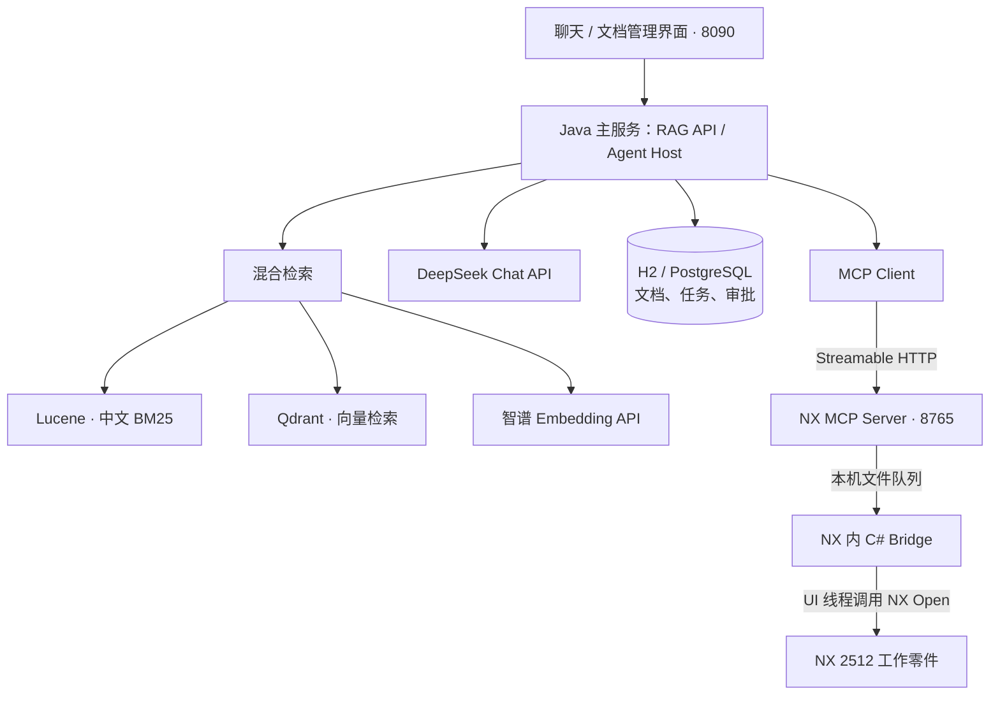

# RAG 项目技术选型与整体架构：问答记录

记录日期：2026-10-12

## 用户提问

目前代码的技术选型和整体架构是怎样的

## 回答

目前代码是 **Java 模块化单体 RAG 服务＋独立 NX MCP 服务＋NX 进程内插件**。定位是可运行、可测试、方便同事集成的单实例基座；企业权限和多节点部署还需要补齐。

这里有两条业务流程：**文档问答走检索与生成；NX 建模由 Agent 同时使用文档依据和实时 NX 工具。**

技术选型如下，版本来自当前代码和配置：

| 层 | 当前选择 | 用途 |
|---|---|---|
| 后端 | Java 17、Spring Boot 4.1.1、Maven | API、业务服务、配置与部署 |
| 模型接入 | Spring AI 2.0.1 | 统一聊天、Embedding 和工具调用接口 |
| 聊天模型 | DeepSeek，当前配置 `deepseek-flash` | 文档回答、NX 工具规划 |
| Embedding | 智谱 `embedding-3`，2048 维 | 文档片段和问题的语义向量 |
| 向量数据库 | Qdrant 1.19.1 | 向量存储、相似度检索，通过 REST Query API 访问 |
| 关键词检索 | Lucene 9.12.3、中文分词、BM25 | 检索术语、编号、精确名称 |
| 检索融合 | RRF，预留模型重排接口 | 合并两路召回；当前没有配置重排模型 |
| 文档解析 | PDFBox 3.0.8、POI 5.5.1 | PDF、DOC/DOCX；另支持 TXT、Markdown |
| 数据库 | Spring JDBC、Flyway；本机 H2 | 文档、片段、任务状态、NX 审批记录；Compose 配置使用 PostgreSQL 17 |
| 前端 | 原生 HTML/CSS/JavaScript | 聊天、文档管理、检索调试、建模确认 |
| MCP | 官方 Java SDK 2.0.1、Spring AI MCP Server | Streamable HTTP 工具通信 |
| NX 集成 | C#/.NET Framework、NX Open 2512 | 在 NX 内读取状态和执行建模 |
| 运维接口 | OpenAPI、Actuator、Micrometer/Prometheus | 接口文档、健康检查、基础指标 |

整体关系是：



**文档入库是异步、可恢复的流程。** 上传后先校验格式、大小和 SHA-256 去重，保存原文件和数据库任务，再由单线程 worker 解析、分块、建立 Lucene 索引、调用智谱生成向量并写入 Qdrant。全部完成后文档才变为 `READY`，允许参与回答。

原文件、数据库、索引、日志和依赖缓存放在项目 `.runtime/` 下。原文件保存在本地，解析文本会发送给 Embedding API，回答需要的证据片段会发送给聊天 API。

**文档问答采用确定性的混合检索管线：**

```text
问题
 → BM25 关键词召回＋问题向量召回
 → RRF 合并去重
 → 校验文档仍处于 READY
 → 可选重排
 → 选取证据片段
 → DeepSeek 生成答案
 → 返回答案、引用、检索模式和警告
```

默认每路召回 30 条，最终使用 6 条。向量服务异常时明确降级为关键词检索；没有证据时返回依据不足。PDF 引用保留物理页码，Word 保留章节。引用编号合法也不等于答案已完成逐句事实核验。

**NX 模式中，Java 主服务承担 MCP Host 和 Agent 编排职责。** 文档用于提供设计规范，MCP 用于获取当前零件的实时状态，两者在 Host 中汇合。当前工具包括：

| 工具 | 能力 |
|---|---|
| `nx_get_context` | 读取当前零件、单位、实体数量和状态快照 |
| `nx_preview_block` | 生成带具体原点、尺寸的待确认计划 |
| `nx_apply_block` | 执行已确认的长方体计划 |
| `nx_command_status` | 查询执行回执 |

模型只能调用读取和预览工具。执行工具由后端确认接口调用，确认记录绑定会话、冻结参数、参数哈希和有效期，并持久化到数据库。

MCP Server 与 NX 插件通过本机文件队列交换请求。插件在 **NX UI 线程**串行执行 NX Open，避免 Java 或 HTTP 线程直接操作 NX。创建后校验实际几何尺寸，支持 Undo/Redo，不自动保存零件。执行超时时标记结果未知，查询回执恢复，避免自动重放建模操作。

代码职责已经分开：

| 目录或包 | 职责 |
|---|---|
| `java-chatbot/.../rag/api、service` | API、文档生命周期、问答流程 |
| `ingest、retrieval、model、store` | 解析分块、检索、模型适配、数据持久化 |
| `java-chatbot/.../rag/mcp` | Agent、MCP Client、审批状态机 |
| `nx-mcp-server` | MCP 工具合同、鉴权、计划校验、桥接通信 |
| `nx-bridge` | NX 进程内执行、几何校验、回执、Undo |

这套结构适合继续作为公司内部基座，但目前有几个明确边界：

- **身份与权限**：共享知识库、服务级令牌，尚无公司 SSO、用户级文档 ACL、项目隔离；NX 审批目前绑定浏览器会话。
- **MCP 写入授权**：确认由 Host 强制执行。Server 还需独立验证写入权限或签名审批票据，防止其他持有 MCP 令牌的客户端绕过页面确认。
- **规模化**：本地文件、嵌入式 Lucene、单 worker 尚不支持直接增加应用副本。扩容需要共享文件存储、共享搜索和任务租约。
- **文档能力与质量**：图片、扫描 PDF 的 OCR 尚未实现；需要用公司真实问题集评估召回、引用、拒答，并决定是否启用重排。
- **NX 能力**：当前只覆盖毫米零件的独立长方体。草图、拉伸、孔、倒角等应逐项增加工具合同和真实 NX 回归测试。

建议先补 **SSO／文档 ACL 和 MCP Server 写入授权**，再根据公司实际文档量、并发量扩展存储和任务架构。

详细说明在 [RAG 架构文档](docs/ARCHITECTURE.md) 和 [NX MCP 架构与生产差距](docs/MCP_NX.md)。
